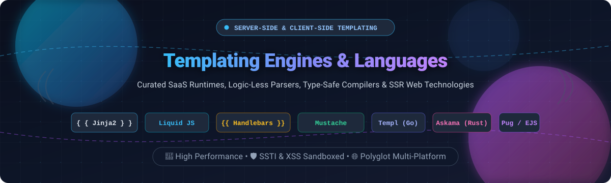

<div align="center">

<a href="https://github.com/ishandutta2007/Awesome-Awesome-Awesome"></a><a href="https://discord.gg/jc4xtF58Ve"></a>
<a href="https://github.com/ishandutta2007/Awesome-Programming-Languages-Templating-Engines/stargazers"></a>
<a href="https://github.com/ishandutta2007/Awesome-Programming-Languages-Templating-Engines/network/members"></a>
<a href="https://github.com/ishandutta2007/Awesome-Programming-Languages-Templating-Engines/blob/main/LICENSE"></a>
<a href="https://github.com/ishandutta2007"></a>

<br/><br/>



# ⚡ Awesome Programming Languages &amp; Templating Engines

### *Curated Polyglot Guide to SaaS Runtimes, Logic-Less Parsers, Type-Safe Compilers &amp; Server-Driven HTML Templating*

[](https://github.com/ishandutta2007/Awesome-Programming-Languages-Templating-Engines/pulls)
[](https://github.com/ishandutta2007/Awesome-Programming-Languages-Templating-Engines)
[](https://github.com/ishandutta2007/Awesome-Awesome-Awesome)

</div>

---

## 📖 Table of Contents

- [🌟 Overview](#-overview)
- [📊 Sector Overview &amp; Market Dynamics](#-sector-overview--market-dynamics)
- [☁️ SaaS &amp; Hosted Templating Platforms](#️-saas--hosted-templating-platforms)
- [💻 Open-Source GitHub Projects](#-open-source-github-projects)
- [🛡️ Security Best Practices: SSTI &amp; XSS](#️-security-best-practices-ssti--xss)
- [🤝 How to Contribute](#-how-to-contribute)
- [💖 Support &amp; Sponsorship](#-support--sponsorship)
- [📈 Star History](#-star-history)
- [📜 Disclaimer](#-disclaimer)

---

## 🌟 Overview

Welcome to the definitive directory of **Programming Languages &amp; Templating Engines**! 🚀 Modern web architectures rely heavily on template engines and markup transformation compilers to power dynamic HTML rendering, email template generation, server-driven UI fragments (HTML-over-the-wire), and compile-time type-safe view models across Python, Rust, Go, JavaScript, TypeScript, PHP, Java, and C#.

Whether you are seeking cloud-hosted SaaS runtimes for customer-facing templates, zero-overhead compile-time engines for microservices, or sandboxed logic-less template parsers, this repository provides battle-tested options, pricing models, and community metrics.

---

## 📊 Sector Overview &amp; Market Dynamics

> **Estimated Market Size**: The global web content transformation, digital experience platform (DXP), and dynamic template rendering software market is estimated at **$16.8 Billion in 2024**, projected to surpass **$38.4 Billion by 2032** growing at a CAGR of ~11.5%.
>
> **Market Fragmentation &amp; Concentration Dynamics**: The hosted CMS and dynamic enterprise template market exhibits a **moderately fragmented yet top-tier concentrated** landscape. Core cloud infrastructure and enterprise CRM/CMS giants (Salesforce, Shopify, Cloudflare, HubSpot) capture a commanding share of commercial storefronts and customer portals through proprietary template abstraction layers (Liquid, HubL, Visualforce). Conversely, the developer-facing runtime layer remains hyper-fragmented and dominated by open-source standards (Jinja2, Mustache, Handlebars, Blade, Twig), where no single vendor exercises a monopoly over view compilation.

---

## ☁️ SaaS &amp; Hosted Templating Platforms

The following hosted SaaS solutions provide managed template rendering, dynamic email compilation, storefront customization, or edge-based HTML manipulation. The table is ordered by company valuation / market capitalization (descending).

| Platform / Vendor | Company Valuation / Revenue | Primary Templating Feature &amp; Use Case | Pricing (Starting Tier) | Free Tier / Trial Limit |
| :--- | :--- | :--- | :--- | :--- |
| **[Salesforce Lightning &amp; Visualforce Cloud](https://salesforce.com)** | **$310 Billion Valuation** (~$34.9B Ann. Revenue) | Enterprise cloud component &amp; markup templating framework powering dynamic CRM workflows, Apex bindings, and Lightning Web Components. | Starting at **$25/user/month** (Starter Suite tier) | **30-day full feature free trial** (Includes sample CRM org &amp; Lightning platform access) |
| **[Shopify Liquid Cloud](https://shopify.dev)** | **$135 Billion Valuation** (~$7.1B Ann. Revenue) | Hosted storefront template runtime processing dynamic Liquid tags, filters, and theme objects across millions of ecommerce stores. | Starting at **$39/month** (Basic Shopify tier, billed annually) | **3-day free trial**, followed by promotional **$1/month for the first month** |
| **[Cloudflare Workers HTMLRewriter](https://cloudflare.com)** | **$36 Billion Valuation** (~$1.3B Ann. Revenue) | Edge-hosted streaming HTML parsing and selector-based template transformation runtime executing at global low latency. | Starting at **$5/month** (Workers Paid tier with 10M requests included) | **Free forever plan**: **100,000 requests/day**, 10ms CPU time/request, 100 worker scripts |
| **[HubSpot HubL](https://hubspot.com)** | **$32 Billion Valuation** (~$2.2B Ann. Revenue) | Proprietary Jinja-inspired templating language (*HubL*) driving dynamic CMS pages, blog modules, and marketing email workflows. | Starting at **$15/seat/month** (Content Hub Starter tier) | **Free forever plan**: Free CMS tools with **up to 25 static website pages** and HubSpot subdomain |
| **[Twilio SendGrid Dynamic Templates](https://sendgrid.com)** | **$10.5 Billion Valuation** (Twilio ~$4.2B Ann. Revenue) | Cloud transactional email infrastructure featuring hosted Handlebars visual editors and code-level dynamic JSON data merging. | Starting at **$19.95/month** (Essentials tier up to 50,000 emails/month) | **Free forever plan**: **100 emails/day** with dynamic template engine and API access |
| **[Webflow CMS Cloud](https://webflow.com)** | **$4.0 Billion Valuation** (~$130M+ Ann. Revenue) | Visual site builder compiling structured CMS collections, nested components, and dynamic symbols directly into production HTML/CSS. | Starting at **$14/month** (Basic Site Plan, billed annually) | **Free forever Starter plan**: **2 static pages**, 50 CMS items, and 1 GB bandwidth on webflow.io |
| **[Vercel Edge &amp; Fluid Compute](https://vercel.com)** | **$3.25 Billion Valuation** (~$100M+ Ann. Revenue) | Managed global edge and serverless runtime optimized for streaming SSR, React Server Components (RSC), and edge templating runtimes. | Starting at **$20/member/month** (Pro plan with 1TB bandwidth) | **Free forever Hobby plan**: **100GB bandwidth**, unlimited personal projects, 100 serverless function executions/day |
| **[Jinja2 Online Cloud Playgrounds](https://palletsprojects.com)** | **Community / Open Non-Profit** (Pallets / PSF) | Web-hosted interactive sandboxes and scratchpads for testing Jinja2, Liquid, and Mustache expression parsing in real-time. | **100% Free / Open Source** (Ad-free public community utility) | **Free forever unlimited**: Unrestricted real-time browser-based code playground execution |

---

## 💻 Open-Source GitHub Projects

Curated open-source templating engines, compile-time markup preprocessors, and HTML-over-the-wire frameworks across multiple programming languages. Sorted by **GitHub Star Count (descending)**.

| Project / Engine | Language Ecosystem | GitHub Stargazers Badge | Description |
| :--- | :--- | :--- | :--- |
| **[Hugo](https://github.com/gohugoio/hugo)** | Go | [](https://github.com/gohugoio/hugo/stargazers) | World's fastest static site generator leveraging Go's context-aware `html/template` runtimes for instant page rendering. |
| **[Jekyll](https://github.com/jekyll/jekyll)** | Ruby | [](https://github.com/jekyll/jekyll/stargazers) | Battle-tested blog-aware static site generator powered by the Liquid templating engine and native GitHub Pages integration. |
| **[Material for MkDocs](https://github.com/squidfunk/mkdocs-material)** | Python / HTML | [](https://github.com/squidfunk/mkdocs-material/stargazers) | Powerful Jinja2-based documentation framework delivering modern, responsive technical sites and design systems. |
| **[Pug](https://github.com/pugjs/pug)** | JavaScript / Node.js | [](https://github.com/pugjs/pug/stargazers) | High-performance whitespace-sensitive template engine (formerly Jade) compiling clean indentation-based syntax into HTML. |
| **[Eleventy (11ty)](https://github.com/11ty/eleventy)** | JavaScript | [](https://github.com/11ty/eleventy/stargazers) | Simpler polyglot static site generator natively supporting Liquid, Nunjucks, Mustache, Handlebars, and JavaScript template literals. |
| **[Handlebars.js](https://github.com/handlebars-lang/handlebars.js)** | JavaScript | [](https://github.com/handlebars-lang/handlebars.js/stargazers) | Semantic, logic-less templating engine extending Mustache with custom helper blocks, partials, and precompiled JS templates. |
| **[Mustache.js](https://github.com/janl/mustache.js)** | JavaScript | [](https://github.com/janl/mustache.js/stargazers) | Minimalist JavaScript implementation of the multi-language Mustache specification for zero-logic template compilation. |
| **[Marko](https://github.com/marko-js/marko)** | JavaScript | [](https://github.com/marko-js/marko/stargazers) | Friendly, reactive HTML templating language compiling into ultra-fast streaming SSR code and minimal client payloads. |
| **[Pelican](https://github.com/getpelican/pelican)** | Python | [](https://github.com/getpelican/pelican/stargazers) | Static site generator written in Python that harnesses Jinja2 templates for full layout and content presentation control. |
| **[Liquid](https://github.com/Shopify/liquid)** | Ruby | [](https://github.com/Shopify/liquid/stargazers) | Shopify's secure, non-evaluating, customer-facing open-source template language engineered specifically for untrusted inputs. |
| **[Jinja2](https://github.com/pallets/jinja)** | Python | [](https://github.com/pallets/jinja/stargazers) | Flagship Python template engine by the Pallets team featuring sandboxed execution, inheritance, and Pythonic expression syntax. |
| **[Templ](https://github.com/a-h/templ)** | Go | [](https://github.com/a-h/templ/stargazers) | Modern HTML component templating language for Go that compiles strongly typed templates into native Go code with IDE autocompletion. |
| **[Nunjucks](https://github.com/mozilla/nunjucks)** | JavaScript / Node.js | [](https://github.com/mozilla/nunjucks/stargazers) | Mozilla's rich JavaScript templating engine inspired by Jinja2, with asynchronous control, macro support, and block inheritance. |
| **[Twig](https://github.com/twigphp/Twig)** | PHP | [](https://github.com/twigphp/Twig/stargazers) | Modern, secure PHP template engine by Symfony that compiles templates down to raw, optimized PHP bytecode with security filters. |
| **[EJS](https://github.com/mde/ejs)** | JavaScript | [](https://github.com/mde/ejs/stargazers) | Simple, lightweight embedded JavaScript template engine allowing developers to script raw HTML with familiar JS tags (`<% %>`). |
| **[Phoenix LiveView / HEEx](https://github.com/phoenixframework/phoenix_live_view)** | Elixir | [](https://github.com/phoenixframework/phoenix_live_view/stargazers) | Compile-time HTML validation and real-time reactive templating language for Elixir and the Phoenix web framework. |
| **[doT.js](https://github.com/olado/doT)** | JavaScript | [](https://github.com/olado/doT/stargazers) | Ultra-concise, blazing fast JavaScript templating engine with zero dependencies and exceptional evaluation benchmarks. |
| **[Tera](https://github.com/Keats/tera)** | Rust | [](https://github.com/Keats/tera/stargazers) | Powerful Rust templating engine modeled after Jinja2 and Django templates, featuring runtime evaluation and custom format filters. |
| **[Askama](https://github.com/djc/askama)** | Rust | [](https://github.com/djc/askama/stargazers) | Compile-time type-safe Jinja-like template engine for Rust generating zero-allocation, ultra-fast rendering code at build time. |
| **[quicktemplate](https://github.com/valyala/quicktemplate)** | Go | [](https://github.com/valyala/quicktemplate/stargazers) | Blazing-fast Go template compiler converting HTML templates directly into static Go functions without reflection overhead. |
| **[Thymeleaf](https://github.com/thymeleaf/thymeleaf)** | Java | [](https://github.com/thymeleaf/thymeleaf/stargazers) | Modern server-side Java template engine processing natural HTML5 templates directly renderable in browsers without server startup. |
| **[MiniJinja](https://github.com/mitsuhiko/minijinja)** | Rust | [](https://github.com/mitsuhiko/minijinja/stargazers) | Minimalist, zero-dependency Jinja2-compatible template engine written in Rust by Jinja's creator, featuring Python and WASM bindings. |
| **[JsRender](https://github.com/BorisMoore/jsrender)** | JavaScript | [](https://github.com/BorisMoore/jsrender/stargazers) | Next-generation jQuery Templates successor providing lightning-fast, string-based HTML rendering for browser and Node.js. |
| **[Smarty](https://github.com/smarty-php/smarty)** | PHP | [](https://github.com/smarty-php/smarty/stargazers) | Classic PHP template engine separating application presentation from business logic with granular template caching. |
| **[LiquidJS](https://github.com/harttle/liquidjs)** | JavaScript / TypeScript | [](https://github.com/harttle/liquidjs/stargazers) | Full-featured, production-ready implementation of Shopify Liquid syntax written in TypeScript for Node.js and client browsers. |
| **[Eta](https://github.com/eta-dev/eta)** | JavaScript / TypeScript | [](https://github.com/eta-dev/eta/stargazers) | Lightweight, ultra-fast embedded template engine designed for Node, Deno, and browsers with native TypeScript caching support. |
| **[Apache FreeMarker](https://github.com/apache/freemarker)** | Java | [](https://github.com/apache/freemarker/stargazers) | Enterprise Java template engine generating HTML web pages, configuration files, and source code from arbitrary Java objects. |
| **[hmpl](https://github.com/hmpl-language/hmpl)** | JavaScript | [](https://github.com/hmpl-language/hmpl/stargazers) | Server-oriented lightweight template language rendering server responses into UI via structured `fetch` bindings. |
| **[Scalatags](https://github.com/lihaoyi/scalatags)** | Scala | [](https://github.com/lihaoyi/scalatags/stargazers) | Type-safe HTML generation library for Scala converting raw code constructs into high-performance web markup at compile time. |

---

## 🛡️ Security Best Practices: SSTI &amp; XSS

When deploying dynamic templating engines in production environments, maintain vigilance regarding the following security principles:

1. **Prevent Server-Side Template Injection (SSTI)**:
   - Never allow untrusted end users to write or upload unescaped template logic when using Turing-complete or reflection-enabled template engines (e.g., Jinja2, Twig, Smarty).
   - Enforce **strict sandboxing environments** or adopt **logic-less specifications** (e.g., Mustache, Liquid) that prohibit arbitrary method invocations on runtime objects.
2. **Context-Aware Automatic Escaping**:
   - Ensure dynamic parameters are escaped according to their specific context (HTML body, HTML attribute, URI query, JavaScript literal, or CSS property).
   - Use built-in context escaping runtimes (such as Go `html/template` or Jinja2 `autoescape=True`) to prevent Cross-Site Scripting (XSS).
3. **Compile-Time Safety**:
   - For backend microservices, prefer compile-time engines (e.g., Askama in Rust, Templ in Go) which validate syntax and types ahead of time, eliminating runtime template missing errors and minimizing payload size.

---

## 🤝 How to Contribute

Contributions, project suggestions, and documentation enhancements are always warmly welcomed! 🌟

1. 🍴 **Fork the repository** on GitHub.
2. 🌿 **Create a feature branch**:
   ```bash
   git checkout -b feature/add-new-templating-engine
   ```
3. 📝 **Add your entry** under the appropriate table following the existing format. Ensure descriptions are factual and links are official.
4. 🚀 **Commit your changes**:
   ```bash
   git commit -m "Add [Engine Name] to Open-Source list"
   ```
5. 📬 **Push and open a Pull Request** with a concise description of the library.

---

## 💖 Support &amp; Sponsorship

Thank you so much for exploring and using this repository! If this resource saved you time or aided your architectural decisions, please consider supporting the project:

- ⭐ **Star this repository** to help other developers discover it!
- 🍴 **Fork and share** the project with your developer network and teams.
- ☕ **Buy me a coffee &amp; Sponsor ongoing curation**: Check out the official [GitHub Sponsor Dashboard](https://github.com/sponsors/ishandutta2007) to back open-source developer tool collections!

---

## 📈 Star History

##  Star History
#[](https://star-history.dera.page/#ishandutta2007/Awesome-Programming-Languages-Templating-Engines&type=date&legend=top-left)`
[](https://www.star-history.com/#ishandutta2007/Awesome-Programming-Languages-Templating-Engines&type=date&legend=top-left)`

---

## 📜 Disclaimer

- This is a community-curated collection intended for educational and architectural evaluation purposes.
- Mentions of commercial SaaS platforms and open-source frameworks do not represent an official endorsement.
- All product names, trademarks, and registered trademarks are the property of their respective owners.

<div align="center">

**Built with ❤️ for web architects, backend engineers, and polyglot developers.**

</div>
